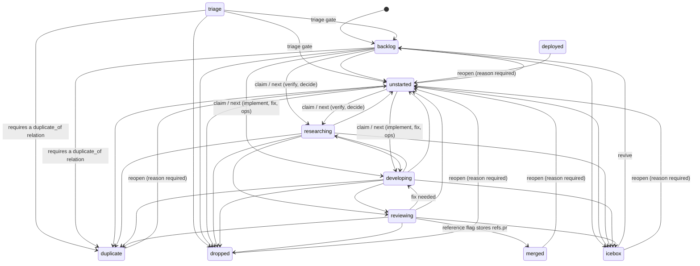

# handoffkeep
A durable home for coding-agent handoffs, working memory, and documents across sessions and machines.

## Fleet console (/ui)

The optional fleet console renders relay timelines, task queues, unresolved
decisions, session checkpoints, and hub status. Authenticated operators can
answer decision items individually or in batches, compose lane events, and
close externally answered decisions with `handoffkeep decisions resolve`. It
is mounted only when the Cloudflare Access configuration is
complete and uses a separate Access assertion from the API bearer token. See
[docs/ui.md](docs/ui.md) for configuration, security boundaries, hub behavior,
and the SSE contract.

Tasks may specify an optional expected duration at creation, for example `tasks add --expected 4h` or `--expected 1d`. Durations must be between 1 minute and 90 days; the server stores a normalized Go duration. The task API returns `expected` as a string, or `null` when unset.

## Fleet metrics

`handoffkeep fleet-metrics --machine <hub id> --since 7d` prints the five fleet
operating metrics (order → usable time, verify rounds, empty task slots,
decision dwell, normal-path share), each with the coverage of the identifiers
it needs; a missing identifier lowers coverage and is never counted as 0. It
only reads (hk GETs, local job directories, `pacelever reps list`, `gh api`).
See [docs/fleet-metrics.md](docs/fleet-metrics.md).

## Version

`handoffkeep version [--json]` prints the binary's embedded build stamp on
one line, or as one JSON object with the same fields: `rev` is the
`vcs.revision` commit, `time` the `vcs.time` commit timestamp, `modified`
the `vcs.modified` dirty-tree flag, `module` the Go module version
(the version tag when the build commit carries one, otherwise a
pseudo-version, for a `go build` inside a git checkout or for
`go install module@ref`; `+dirty` is appended when the tree is dirty;
`(devel)` appears only when the build has no VCS stamp), and `go` the
toolchain version.
`rev=unknown` means the
binary carries no VCS stamp — it was built with `-buildvcs=false`, without
a `.git` directory, or via `go install module@ref` (where `module` shows
the requested version, a tag or a pseudo-version). The command reads no
environment, config, or server. The server reports the same stamp at
`/healthz`.

## Sentry errors and tracing

`handoffkeep serve` optionally sends errors and request performance to Sentry:

| Variable | Behavior |
| --- | --- |
| `HANDOFFKEEP_SENTRY_DSN` | Enables Sentry when set; unset disables it completely. |
| `HANDOFFKEEP_SENTRY_ENV` | Environment name; defaults to `production`. |
| `HANDOFFKEEP_SENTRY_TRACES_SAMPLE_RATE` | Request sampling rate from `0` to `1`; defaults to `0.2`. Invalid values fail startup. `0` keeps error reporting enabled. |

Release is the binary's `vcs.revision` build stamp (`unknown` if unstamped).
The operator provisions the project and injects the DSN at deployment.

Every request except `/healthz` gets a server-generated request id, returned
in `X-Request-ID` whether or not Sentry is enabled; a client-sent
`X-Request-ID` is ignored. A `/v1` `500 internal_error` body carries the same
id as `request_id`, and so does its `api.internal_error` log line (with the
route template and authenticated client).

Each sampled HTTP request sends one transaction named by its route template,
including API, MCP, webhook, and console requests. It includes HTTP method,
status, duration, and the request id as the `request_id` tag.
DB spans include normalized SQL, PostgreSQL operation status, rows affected,
and duration. Bind arguments, SQL literals, comments, and quoted identifiers
are removed. Transactions retain at most 999 child spans. `/healthz` emits no
telemetry. Pending events flush for up to two seconds after shutdown drains.

All handler 5xx responses and panics are reported, even for unsampled
requests, except a 5xx whose client already disconnected (request context
cancelled), which only finishes its transaction. A 5xx event is grouped by
`["http-5xx", <method + route template>, <status>]`, so each route and status
is its own issue; panics keep stack-based grouping. When the body is a JSON
error with a snake_case code (`internal_error`, `quota_store_unavailable`),
that code is the `error_code` tag. Panic stack frames are retained; error and panic messages use
generic text. The scrub list removes headers (including Authorization and
cookies), URLs and query strings, request/response bodies, document content,
user identities, hostnames, breadcrumbs, arbitrary tags/contexts/extras,
attachments, and stack locals/source text. No query arguments, returned DB
values, or database error text are attached.

## Tasks

`tasks` is the durable, Postgres-backed work queue for captains. A task belongs
to a lane; `parent_lane` lets a parent captain list pending decisions from its
child lanes. Creation starts in `backlog`. Claiming and `next` are atomic, so
only one session can claim an item. Every state change, including a claim, is
recorded in `task_events`.

```bash
handoffkeep tasks add --lane lane-a --title "add queue endpoint" --kind implement --priority 10
handoffkeep tasks list --lane lane-a --state backlog
handoffkeep tasks next --lane lane-a --by session-a  # exits 3 when empty
handoffkeep tasks transition 42 --to reviewing --pr https://github.com/org/repo/pull/7 --note "PR open"
handoffkeep tasks rebind 42 --from-job old-job --to-job new-job --by new-builder --reason "builder takeover"
handoffkeep tasks transition 42 --to needs_decision --question "Which interface should own this?"  # sets the awaiting_decision flag
handoffkeep tasks relane 42 --to lane-b --note "triage follow-up"
handoffkeep tasks list --parent-lane lane-a --state needs_decision  # tasks with the awaiting_decision flag
handoffkeep tasks show 42
handoffkeep tasks export [--lane L --state S --parent-lane P --limit N]
```

`add` accepts `--parent-lane`, `--pr`, `--head-sha`, `--report-path`, and
`--job-id` as durable references. `transition` accepts the same reference flags.
`tasks rebind` transfers an active task from one job id to another without
changing its state. It requires a server that implements
`POST /v1/tasks/{id}/rebind`; the minimum server revision is the handoffkeep
PR 1 head revision recorded in that PR's description.
`needs_decision` always requires `--question`. `add` also accepts the typed
origin relations `--origin-pr <merged PR URL>` and `--origin-task <id>`
(`refs.origin_pr` / `refs.origin_task`, "this row came from"; `closing_pr` is
reserved for #494).

Each task may carry an optional `area`, a routing tag from a closed list of 13
values kept in code (`handoffkeep tasks areas`, `GET /v1/task-areas`):
blender, unity, web-qa, ui-design, image, web-frontend, go-backend, python,
trading, shell-wrk, docs, research, ops. `tasks add --area A` sets it at
creation; `tasks set-area 42 docs --note why` and `tasks set-area 42 --clear`
(`POST /v1/tasks/{id}/area`, body `{"area": "docs" | null, "note": "..."}`)
change it, writing one `kind='area'` `task_events` row with the old and new
value, and nothing when the value is unchanged. `tasks list --area A`
(`GET /v1/tasks?area=A`) filters; `--area ""` selects tasks with no area. An
unknown value is a 400 `invalid_request` naming the allowed set. The
console only reads it, and the MCP server has no task tools. Area is routing
metadata, not authority: it is not part of any claim or receipt and is not
fenced like project or rebind.

`add --doc <key>` attaches the task body: `tasks.body_doc` holds only the hk
document key (or the transitional `key#section`, where the section is a scroll
position), while the body text stays in `documents` (`doc put` / `doc get`).
Only the key shape is checked — the document may be written later — and the
console's task overview renders that document inline. No other subcommand
writes `body_doc`; `--doc` elsewhere is refused.

### Disposition items (merge → operator)

A disposition item is a `kind=decide` task whose `refs.disposition` records one
source (exactly one of `origin_pr` or `origin_task`), facts copied from tools
(merge SHA and time from `gh pr view --json url,state,mergeCommit,mergedAt`,
install state with a witness doc or `unknown`, residual count from a list), a
closed choice set (A 배포 · B 후속 발주 · C 잔여 수용 · D 보류 · E 조치 없음)
and one recommendation. It is created directly with the `awaiting_decision` flag set inside one
transaction, so it is never claimable; at most one item per source is open.

```bash
gh pr view <url> --json url,state,mergeCommit,mergedAt > pr.json
handoffkeep tasks disposition add --lane lane-a --origin-pr <url> --gh-json pr.json \
  --residuals residuals.json --recommended C [--install-state unknown]
handoffkeep tasks disposition summary [--as-of RFC3339] [--json]
handoffkeep tasks disposition apply <id> [--note text]
```

Only the operator's Access-authenticated web route answers an item
(`/ui/dispositions/answer`, `/ui/dispositions/accept-batch`); generic
transitions, `decisions resolve`, and compose are refused with
`disposition_operator_only`. Silence changes nothing: no code path answers,
demotes, or claims an open item. `apply` records the director's application of
the operator's answer with legal edges only (A/B/C → `merged`, D → `icebox`,
E → `dropped`); an item never returns to `backlog`. An "A 배포" answer is
consent to order a deploy; deploy windows and the installer procedure are
unchanged. `summary` is the one definition of the digest header
(`미처분 n · 최고령 x일`, plus `다음 묶음 m건` beyond 50) and is replayed
from `task_events`, so `--as-of` reproduces a past header. Bearer routes:
`POST /v1/tasks/dispositions`, `GET /v1/tasks/dispositions/summary`,
`POST /v1/tasks/dispositions/{id}/apply`.



### State model, hierarchy and relations

`tasks.state` holds one of eleven states; the category is derived from it and
is never stored (API rows carry it read-only as `category`):

| Category | States |
|---|---|
| `triage` | `triage` |
| `backlog` | `backlog` (claimable) |
| `unstarted` | `unstarted` (claimable) |
| `started` (open) | `researching`, `developing`, `reviewing` |
| `completed` | `merged`, `deployed` |
| `canceled` | `dropped`, `duplicate`, `icebox` |

Open means `started` and nothing else. A claim (`tasks claim`, `tasks next`)
serves `backlog` and `unstarted` and sets the sub-state from the task kind:
`implement`, `fix` and `ops` give `developing`; `verify` and `decide` give
`researching`. Entering a started state needs `claimed_by` plus `refs.job_id`
or a no-job reason. Waiting on the operator is the `awaiting_decision` flag,
not a state: the task keeps its work state, cannot be claimed while flagged,
and the answer paths clear the flag. A task leaves `triage` for `backlog` or
`unstarted` only with a priority above 0, a project and a kind. No manual edge
enters `deployed`, and a task cannot enter `merged` from `researching` or
`developing` by hand.

Old state names still work as input and in `--state` filters (`in_progress` →
the claim's sub-state, `verifying` and `join` → `reviewing`, `hold` →
`icebox`, `needs_decision` → set `awaiting_decision`, `claimed` → the claim
path, `reopened` → the reopen path); responses use only the current names.

`task_origins` records where a task came from by the provider's durable id,
not by its display number: `tasks origin add <id> --provider linear
--namespace NS --external-id <issue UUID> [--display-ref MGH-151]
[--origin-url U] [--title T]`. A task may have any number of origins. Adding the
same UUID again (an issue that moved from MGH-151 to ROB-1514) refreshes the
display number, URL and title and makes no second row; `tasks origin list <id>`
lists a task's origins and `tasks origin find --provider P --external-id UUID`
finds every task that came from one external object. (`--url` stays the hk
server, so the origin's own URL is `--origin-url`.) Origins between hk tasks are
`task_relations`. `doc put --task N --origin-class authored|job|import` names the
task a document belongs to and how it came to be (kinds `decision`, `research`,
`design`, `policy` and `evidence` are accepted too); `doc list --task N` lists
them. A re-put that omits the two keeps the stored values; an unknown value
stays NULL.

`tasks.parent_id` is a single, acyclic parent (`tasks add --parent <id>`,
`tasks parent <id> --to <parent>|--clear`). `task_relations` holds `blocks`,
`duplicate_of` and `related` edges (`tasks relate|unrelate <id> --kind K
--other <id>`): self-links and `blocks` or `duplicate_of` cycles are refused,
removing an edge archives it (`archived_at`) and adding it again revives it.
`duplicate_of` and the `duplicate` state are written in one transaction
(`tasks transition <id> --to duplicate --duplicate-of <other>` does the same
thing). `blocks` is informational. With `auto_close_parent` on (the default),
a parent closes when its last sub-task settles: `deployed` if every completed
sub-task is `deployed`, otherwise `merged`; a sub-task in `icebox` or any open
state blocks the close, and a parent whose sub-tasks are all `dropped` or
`duplicate` stays where it is, with the skip recorded as an `auto_close`
event. Reopening a sub-task records an event on a completed parent and does
not reopen it.

### Triage intake, ticket sets and the duplicate check

Integrations put work into `triage` with `POST /v1/intake` (`tasks intake
--source S --source-ref R --title T [--body B|--body-file F] [--project P]
[--kind K] [--priority N] [--lane L]`). A repeated `(source, source_ref)`
returns the recorded task with `created:false`. Project, kind and priority may
be left unset; an unset kind is valid only in `triage`, and on a task declined
from it (which then cannot be reopened). A body is stored as
the document `task-body/<id>` and linked by `body_doc`.

A repo session emits a whole ticket set with `POST /v1/ticket-sets` (`tickets
emit --file set.json`; the document is described in
`docs/linear-internalize.md`, "Ticket sets"). Every body needs the headings
Current, Desired, Key interfaces, Out of scope and Acceptance. One transaction
creates the parent, the children (`parent_id`), their bodies and the `blocks`
edges (`blocked_by` names a `ref` in the set or an existing task id); an
unknown reference or a cycle refuses the whole call. The same payload again
returns the same ids; a changed payload is refused with 409
`ticket_set_conflict`.

The triage gate: `tasks transition <id> --to backlog|unstarted` needs a
priority above 0, a project and a kind, which the exit can set (`--priority N
--kind K --project P`); `--to dropped|duplicate` needs a `--note` reason.
Every exit sets `triaged_at` and records the caller as the event's `by`.
`--set` applies the exit to the task's children still in triage in the same
transaction: an accept moves them to the same state, each inheriting
priority, kind and project unless it has its own; declining a ticket set's
parent drops its children still in triage, with or without `--set`.
`GET /v1/triage` (`tasks triage`) lists the queue oldest first, a ticket set
as one row (its parent, `child_count`, `age_seconds` and similar open tasks)
while its parent is in triage.

`tasks add` and `POST /v1/tasks` refuse a title similar (pg_trgm similarity
of at least 0.5) to a `backlog`, `unstarted` or started task with 409
`similar_tasks`, listing them. Pass `--link <id>` (`"link"`) to file it
related to one of them, or `--new` (`"new": true`) to file it anyway.
Ticket sets never stop for this check.

### Event-driven transitions, stalled and the backlog sweep

Integration events move tasks forward under the rules in
`docs/linear-internalize.md` ("Event-driven transitions").
`POST /v1/task-events` takes `{source, source_ref, task_id, pr, reverted_pr,
revert_pr, at}` for `mergewake.pr`, `mergewake.review`, `mergewake.merge` and
`mergewake.revert`; `source_ref` is the PR URL, and for a revert the revert PR
URL with `reverted_pr` naming the PR it undoes. Every event is recorded in
`task_events` with its source, applied or not, and the answer carries
`applied`, `redelivered`, `state` and, when nothing moved, `reason`. The same
`(task, source, source_ref)` again changes nothing. `handoffkeep tasks event
<id> --source S --source-ref URL [--reverted-pr URL]` posts one by hand.
Storing a `deploy/<service>/<YYYYMMDDTHHMMSSZ>` document whose record has
`result` `success` and a non-null `included_prs` moves each `merged` task whose
`refs.pr` is listed to `deployed` (`hk.deploy`); a task that enters `merged`
later finds the record then. A job record that gains a role moves its bound
task from `researching` to `developing` when the role and kind say so, never
back.

A task is `stalled` (a read-time field on task rows) when it is in a started
state, not `awaiting_decision`, and its newest task event, comment or bound
job update is older than `serve --started-stalled-hours` (default 24).
`tasks list --stalled` (`GET /v1/tasks?stalled=true`) lists only those.
`serve --backlog-icebox-days N` parks `backlog` tasks idle for N days in
`icebox` with an `hk.sweep` event, skipping flagged tasks and parents with
started sub-tasks; the default 0 keeps the sweep off. `handoffkeep tasks sweep
--dry-run --days N` (`GET /v1/tasks/sweep?days=N`) prints what it would move
and writes nothing. `--started-stalled-hours` takes 1..8760 and
`--backlog-icebox-days` takes 0 or 1..3650; serve refuses anything else at
startup, and the preview answers `400 invalid_context` outside 1..3650.
Schema version 34 adds the `source_event` kind for events
recorded with `applied=false`, so they never read as transitions.

### Desk ledger and project status updates

`GET /v1/ledger?consumer=<name>` (`handoffkeep ledger [--consumer desk]
[--json]`) returns the desk's view in five sections, always in this order:

1. `in_flight`: started tasks that are not waiting on a decision and not
   stalled, each with its newest event and `next_trigger` (`review`, `merge`
   or `deploy`, with the source that sends it). The header lists every project
   with started tasks, its latest status update and `stale` when that update
   is older than 7 days or missing.
2. `waiting_on_operator`: open, not snoozed decision requests, grouped by
   task in the order of each task's oldest request; requests with no task last.
3. `stalled`: stalled started tasks, oldest activity first, and `mergewake.merge`
   events from the last 7 days recorded `applied=false` for a task that is
   still canceled.
4. `triage`: tasks in `triage`, oldest first, with the oldest item's age.
5. `changed_since_ack`: the change-feed delta after the consumer's cursor,
   counted per model and action, with the first 100 rows.

A task appears in at most one of the first three: one with the
`awaiting_decision` flag or any open decision request is only under Waiting,
and a stalled task only under Stalled. Reading never moves the cursor.
`POST /v1/ledger/ack {consumer, sync_id}` (`handoffkeep ledger ack [--consumer
desk] <sync_id>`) moves it forward; a lower `sync_id` is refused with `409
ledger_ack_backward`. Before its first ack a consumer has no cursor and an
empty delta, and the first ack starts the cursor at the feed's current
`max_sync_id`. A cursor older than the feed's reset boundary answers `410
{"reset":true,"min_sync_id":N}`, as the feed does; ack a current `sync_id` to
continue. `handoffkeep since [--consumer desk] [--json]` prints section 5 with
its rows.

`POST /v1/projects/{name}/status-updates {health, body}` (`handoffkeep tasks
project-status <name> --health on_track|at_risk|off_track --body <text>`)
records a project's health. The server stores the project's task counts by
category as `snapshot` and the change from the previous update as `diff`.
`GET` on the same path (`handoffkeep tasks project-status <name> [--limit
N]`) lists updates newest first with the project's `stale` flag. Schema
version 36 adds `ledger_cursors` and `status_updates`.

The schema migration to this model (version 32) moves existing rows by the
map in `docs/linear-internalize.md` and is reversible with
`scripts/rollback-state-migration.sql`; `handoffkeep tasks migrate-states
--dry-run` (reads `HANDOFFKEEP_DB_URL`, writes nothing) prints the counts per
`(legacy_state, rule, new_state)` before the server is upgraded.

The HTTP API uses the usual bearer token: `POST /v1/tasks`, `GET /v1/tasks`,
`GET /v1/tasks/{id}`, `POST /v1/tasks/{id}/claim`, and
`POST /v1/tasks/{id}/transition`. `POST /v1/tasks/next` supports the CLI's
atomic `next` operation. Invalid state changes and competing claims return 409.
A claim may carry `job_id`: the server writes `claimed_by` and `refs.job_id`
in the same transaction, and replaying the identical claim (same claimant,
same non-empty job id) is a no-op that returns the row instead of a 409.
`POST /v1/tasks/relane` moves tasks between lanes without touching state,
priority, refs, or claimant: `{"ids": [42], "to": "lane-b", "note": "why"}`.
Each id commits independently and every item reports `ok`, `changed`, or a
stable error (`not_found`, `task_terminal`, `unknown_lane`, `task_conflict`,
`secret_like_content`, `invalid_task_relane`, `internal_error`). A target
lane no current row uses is refused unless
`"allow_new_lane": true`; merged/dropped tasks are always refused. The move is
recorded as an append-only `task_events` row with `kind='relane'` — `from`/`to`
carry lane names, not states — so state readers never mistake a relane for a
transition. The event's `by` is the bearer-token client id.

```bash
handoffkeep tasks relane 42 --to lane-b --note "triage follow-up"
handoffkeep tasks relane --ids 33,37,38 --to lane-b --note "batch move"
handoffkeep tasks relane --ids - --to lane-b --note "stdin ids"   # whitespace-separated
handoffkeep tasks relane 42 --to lane-new --note "w" --allow-new-lane
```

The CLI prints `{"results": [...], "moved": N, "unchanged": N, "failed": N}`
and exits nonzero when any item fails. A relane to the task's current lane is
an idempotent no-op: `changed` is false and no event is written. A request
takes at most 500 ids (the CLI refuses larger batches locally) and the CLI
deadline scales with the id count so a max-size batch cannot expire silently
mid-request.
### Decision requests

A question put to the operator is recorded on its task before any pane
notification (#618). Schema v14 widens the `task_events.kind` CHECK to admit
`decision` as `NOT VALID` (a catalog-only change, with no scan of existing rows
under the exclusive lock); `ALTER TABLE task_events VALIDATE CONSTRAINT
task_events_kind_check` can be run later without blocking reads or writes. The request lives in `refs.decision_request` next to the
existing `refs.decision_options`; every write appends a `task_events` row with
`kind='decision'` (from = to = the current state) whose refs snapshot keeps the
full request, so history is read back from events and no table is added.

```bash
handoffkeep tasks decision-request 42 --question "Where should the allowlist live?" \
  --option 'A|writer spec' --option 'B|backfill tool' --recommended A --reason "one choke point" \
  --default-action "hold and move to the next task" [--default-option B] \
  [--default-trigger "director applies after the deadline"] [--due 2026-09-25T18:00:00+09:00] \
  [--doc key] [--supersedes dr-42-1] [--block]
handoffkeep tasks decision-resolve 42 --request dr-42-1 --kind answered --option A --responder operator
handoffkeep tasks decision-resolve 42 --request dr-42-1 --kind default_applied --receipt <evidence>
handoffkeep tasks decision-resolve 42 --request dr-42-1 --kind withdrawn --text "no longer relevant"
```

The CLI prints the `request_id` (`dr-<task>-<revision>`) and a `notify` line
to paste into the pane message. A failure before the request is sent, or a
refusal the server sends (401/403/404/409 or a named 400), says `NOT
recorded`: the request must not be announced as visible in the console. A
transport error, timeout, undecodable reply, 5xx or the catch-all 400
`invalid_context` after the request was sent says outcome `UNKNOWN` and exits
4, because the server may already have committed: check `tasks show <id>` or
re-send the identical command, which returns a recorded request as
`duplicate`, before notifying. A value flag never takes the next flag as its
value (`--reason --block` is refused); pass text that starts with `-` as
`--reason=-text`. The recommendation,
the no-response action (required; write "자동 적용 없음" when nothing is
applied) and the deadline are separate fields. Option labels are at most 120
bytes (not characters); longer outcome text goes in `--doc`. A byte-identical
re-send returns the recorded request (`duplicate`); a different request while
one is open is refused (`decision_request_open`) unless `--supersedes` names
it, and the new revision starts with no answer. `--block` also sets the task's
`awaiting_decision` flag; without it the flag is unchanged. Nothing is applied on
a timer: a passed deadline is shown as "deadline passed, not applied" until a
`default_applied` resolution with a receipt is recorded. Open requests left on
merged/dropped tasks are listed as uncleaned and closed with
`decision-resolve`. Once a task has a request, generic `transition --to
needs_decision` and option patches on it are refused, and while the request
is open the flag cannot be cleared by the generic answer paths: record the
answer with `decision-resolve` first, then resume. The console (queue row
badge and count, drawer card, Decisions) reads these records only; answering
from the console is #580.

Every CLI, assistant and console answer to a `dr-` request goes through one
store entry, `Store.ResolveDecision`. It records an append-only attempt
(`decision_answer_attempts`) and, for an answer, one resolution per logical
request and revision (`decision_resolutions`), and the response carries a
`result`: `answered`, `conflict`, `stale_revision`, `pending_confirmation`,
`expired` or `superseded`. `--event-key KEY` (or `event_key` in the body)
makes a re-sent delivery replay the first result; the same key with another
answer is `409 decision_event_key_conflict`. Provenance comes from the
verified channel: the bearer client `operator` and an Access-authenticated
console user answer as `operator_direct`; any other client, or an assistant
quoting the operator, is a relay. A `human_only` request does not close on a
relay: the call answers `202` with `result: pending_confirmation` (the CLI
prints it and exits 0), the request stays open, and a later `operator_direct`
answer closes it. The console route is `POST /ui/api/decision-requests/resolve`
with `{request_id, option, text, event_key}`.

`GET /v1/tasks/export` returns one consistent snapshot of the queue — a
single bounded JSON document carrying the snapshot ID, watermarks, filtered
counts, integrity digests, and the task rows — read inside one repeatable-read
read-only transaction. `handoffkeep tasks export` prints the document
unchanged; see docs/contract.md for the full envelope and digest contract.

### Task comments

Each task has an append-only comment thread in `task_comments`. A comment is
data only: writing one never changes the task's state, priority, refs,
`task_events`, lane events, or any decision, whatever its text says (a
`[decision] #42: …` comment is just text). There is no edit or delete; a
database trigger rejects `UPDATE`, `DELETE`, and `TRUNCATE`, so a correction is
a new comment. The author is always the bearer-token client id — a request
carrying `author` or `created_by` is refused with `400 author_not_accepted`.
Comment ids increase in commit order, so `after_id` works as a read cursor.

```bash
handoffkeep tasks comment 42 --body "verified on head abc123"
handoffkeep tasks comment 42 --file notes.md   # --file - reads stdin
handoffkeep tasks comments 42 [--after-id N --limit N]
```

`POST /v1/tasks/{id}/comments` takes `{"body": "..."}` and returns 201.
`GET /v1/tasks/{id}/comments?after_id=&limit=` returns `{"comments": [...]}` in
id order (limit default 100, max 500). Errors are distinct: 401
`unauthorized`, 400 `comment_empty`, 413 `comment_too_long` (body over 64 KiB),
404 `not_found` (no such task), 400 `secret_like_content`.

## Documents and search

`doc get <key>` fetches a document by key; `doc get --id <n>` fetches one by
its numeric id (`GET /v1/documents?id=<n>`, `404 not_found` when absent,
`400 invalid_document_id` for a malformed id). `ctx search --scope docs` and
`ctx search --scope all` treat a bare-number or `#<n>` query as a document-id
lookup — the exact match leads the page and a missing id returns an empty
result set, the same way
`--scope tasks` resolves task ids. Search pages default to 20 rows (hard cap
100, `--scope tasks` 50); a page cut at the cap marks every row
`truncated: true` rather than presenting a partial set as complete.

## Relay events

Relay events persist worker completion, escalation, and join reports before a
hub delivers them to an owner lane. Clients use `POST /v1/relay/events` to
append an event, `POST /v1/relay/events/{id}/delivered` with
`{"machine":"host-a","pane":"w1:p1"}` to record delivery, and
`GET /v1/relay/events?undelivered=1&lane=lane-a` to find work still awaiting
delivery. Omitting `lane` lists every lane; `undelivered=1` (or `true`) is for
recovery workers that must only retry events without a recorded delivery. The
additive `kind` parameter selects one supported kind, and `after_id` is an
exclusive durable-ID cursor; use the last returned ID as the next `after_id` to
advance through a recovery backlog without repeating an earlier page.

For the job kinds — `job.completed`, `job.escalate`, `job.joined`,
`job.lost`, and `job.revoked` — the idempotency key is
`(kind, job_id, epoch, report_path, reason)`. A first append returns 201; a
duplicate returns 200 with the same event ID. `attempts` starts at zero and
increases once for every duplicate receipt, so it measures duplicate receive
attempts rather than successful deliveries. Panewire sends the durable job
event filename as `event_id`; job kinds store it, but deduplication still
uses the five-field key, never that producer filename.

`lane.event` is a directly addressed, durable lane notification. Its required
fields are `kind: "lane.event"`, `owner_lane`, `event_id`, and `text`; its
idempotency key is `(owner_lane, event_id)`. `owner_lane` is the destination
lane, not a parent-routing hint. `text` must be nonempty, at most 2048 bytes,
and contain no NUL or C0/C1 control characters (including tab, CR, and LF).
Job event kinds reject a nonempty `text`; their `event_id` is a stored
producer label rather than a deduplication input, so the two idempotency
families stay unambiguous. As with job events, duplicate lane-event
posts return the first writer's original row, increment `attempts`, and never
change `delivered_at`.

## Operator chat

Desk sessions post operator-facing final answers and questions; operators post
answers in the browser. The single conversation ID is `operator-desk`. This
service owns persistence; the chat screen lives in the hub.

`POST /v1/chat/messages` accepts `conversation_id`, `author`, `body`,
`source_channel`, `origin_event_id`, `origin_timestamp`, `questions` (desk
objects with `id`, `lane`, `body`), `question_ids` (operator reply targets),
and `processed_question_ids` (desk's explicit resolutions). A desk post
commits its body, question upserts, posted and resolve relations, and processed
transitions in one transaction. An operator post commits its body and reply
relations in one transaction. Every referenced Q must belong to the
conversation. Replies and delivery never resolve a Q. Each message response
and list row carries `question_relations` with a durable `question_text`
snapshot, plus the conversation, source, and original event fields. Lists are
ordered by server insertion ID; original timestamps do not reorder rows.

The event key is `(conversation_id, source_channel, origin_event_id)`. A
semantic replay returns the prior row with HTTP 200; a different body, author,
question post, reply target, or processed target on that key returns HTTP 409
before any Q mutation. A new event ID creates a new row even if the text is
identical. New web and hook clients must send an event ID. Legacy clients may
omit the new fields: they get conversation `operator-desk`, source `legacy`,
and a fresh row per request. The complete JSON request is limited to 68 KiB;
within it, the body and each question body have a 64 KiB field limit.
Secret-shaped content is rejected without echoing it.

`PUT /v1/chat/questions/{id}` (or `POST /v1/chat/questions` with the ID in the
body) still upserts by producer Q ID. Question upsert and list rows include
`conversation_id`. `GET /v1/chat/questions?conversation_id=&lane=&state=&after_id=&limit=`
pages by full Q ID. `GET /v1/chat/questions/{id}` returns one authenticated
question or 404, so a reply can validate a question outside the recent page.
`POST /v1/chat/questions/{id}/transition` still explicitly
resolves or withdraws a pending Q.

Operator messages start `stored`; `POST /v1/chat/messages/{id}/delivered` or
`/{id}/failed` changes their relay state. Desk messages start `not_sent` and
cannot use those transitions. `GET /v1/chat/messages?conversation_id=&author=&undelivered=1&after_id=&limit=`
pages by message ID; `undelivered=1` includes only stored operator rows. Daily
retention prunes resolved or withdrawn questions and delivered operator rows
older than one year, at most 1000 per table per run. It preserves desk rows,
pending questions, and stored or failed operator rows. Relation snapshots
survive Q pruning until their message is pruned.

Migration defaults older rows to the single conversation and `legacy`
source, retaining their bodies. It backfills an older reply relation only when
a durable `lane.event` relay row explicitly identifies both the chat message
ID and Q; otherwise the relation list is empty. It never invents a desk body.
Deploy this store before the new hub and hook. Old clients keep using legacy
mode; newer clients must treat an older store's rejection of the extended
request as a visible incompatibility and keep their pending posts for retry.

## Attachments (R2)

Attachments are immutable, content-addressed private R2 objects. Configure all
four S3 settings to enable them: `HK_S3_ENDPOINT`, `HK_S3_BUCKET`,
`HK_S3_ACCESS_KEY_ID`, and `HK_S3_SECRET_ACCESS_KEY`. R2 uses region `auto`
and path-style requests. When any setting is absent, only attachments are
disabled; checkpoints, memory, and documents continue to work.

The default safety limits are a 50 MiB object maximum, 8 GiB total storage,
800,000 monthly writes, and 8,000,000 monthly reads. Set the corresponding
`HK_ATTACH_*` variables to positive values to adjust them. Text attachments
are secret-scanned, MIME is sniffed and allowlisted, and dump/archive filename
extensions are rejected. Objects are never made public.

```bash
handoffkeep attach put image.png --checkpoint 42
handoffkeep attach get SHA256 -o image.png
handoffkeep attach list --doc jobs/example/brief.md
handoffkeep attach usage
handoffkeep r2usage --alert
```

HTTP clients use raw `PUT /v1/attachments` with `X-HK-Name`, `Content-Type`,
and optional `X-HK-Ref` (`checkpoint:<id>`, `document:<key>`, or
`memory:<agent>/<name>`). `GET /v1/attachments/{sha}` streams through the
service; add `?presign=1` for a ten-minute private URL. `/v1/usage` and
authenticated `/metrics` expose the local fuse counters. `/metrics` also
reports, per authenticated client, the CLI revision from its last
`User-Agent: handoffkeep/<rev>` request
(`handoffkeep_client_revision_info{client,rev} 1` and
`handoffkeep_client_last_seen_seconds{client}`). This is process memory: a
restart forgets it until each client calls again. The server logs
`api.client_revision client=... rev=... prev=...` when a client's revision
changes (including its first request after a restart). `r2usage` is optional
and safely reports `skipped` when Cloudflare analytics credentials are absent.

## O3 contract fixture pack

`testdata/o3/` is the machine-readable contract pack for the O3 authority
design (`hk:doc designs/hk1873/b1873a-sol-r4`, doc 44185, revision 4,
amendment 1): the Draft 2020-12 schema bundle, every normative vector
table as data, sanitized legacy event fixtures, the command matrix, CLI
subcommand/exit maps, and a hashed manifest. It changes only with a new
design revision. `go test ./internal/o3contract/...` verifies the pack
against itself — schema validity, internal ref resolution, per-vector
request/record conformance, error-code/exit-map consistency, manifest
hashes, and per-table case counts. See `testdata/o3/README.md`.

## Container image


CI builds `ghcr.io/mgh3326/handoffkeep` — a single static binary on distroless,
running as nonroot — on every PR, and pushes it (tags: full commit SHA and
`main`) on each `main` push. Image contents, tag rules, the `vcs.revision`
verification command, and the environment-variable name list live in
[docs/image.md](docs/image.md). This pipeline produces the image only; the
deployment path is unchanged.

### Reopening a task

`handoffkeep tasks reopen <id> --reason "reverted after failed smoke"` calls
`POST /v1/tasks/{id}/reopen` with `{"reason":"reverted after failed smoke"}`.
Only a settled task (`merged`, `deployed`, `dropped` or `duplicate`) or an `icebox` task can be reopened, and it returns to `unstarted`. The
operation requires a non-empty reason, records the authenticated caller and
reason as an append-only transition audit event, and clears the claimant and
per-cycle `job_id`, `pr`, `head_sha`, and `report_path` refs. Previous values stay
in `task_events`. Disposition items cannot be reopened or claimed directly.
Generic transitions cannot leave a settled state. Existing protected task/job
authority fences also apply to reopen, which clears bindings; the operation does
not bypass protected enrollment. Reopened tasks appear in the
queue as `unstarted` and are eligible for claim/next, `researching` or `developing`
(with normal job linkage or an explicit no-job reason), `icebox`, `dropped` or `duplicate`. Historical merges remain
in the event log; deploy views use the latest merge of currently merged tasks.
